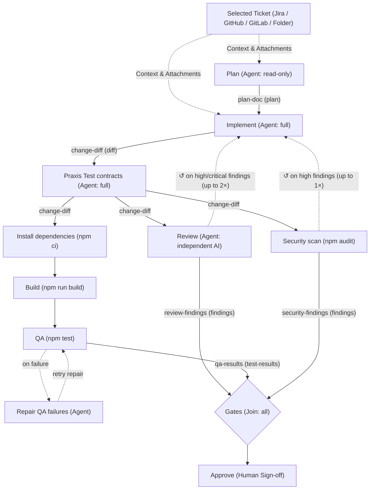
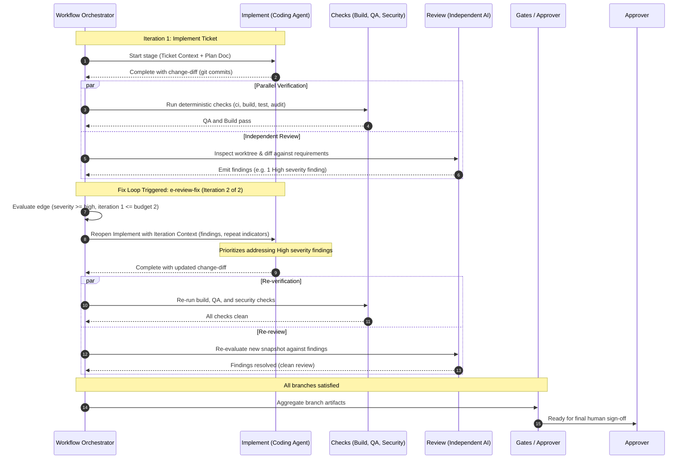
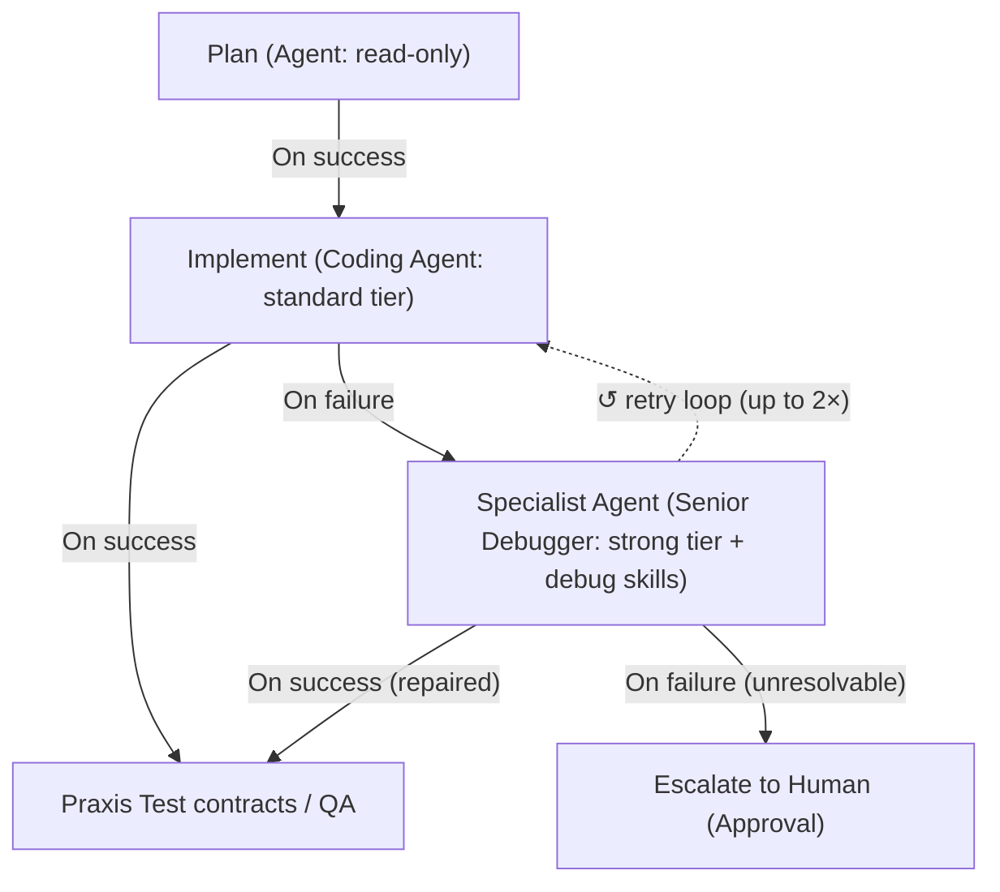

# Governed delivery workflows

A workflow is a validated DAG of stages a project runs to deliver one unit of
work: agents implement, deterministic checks verify, and a human approves — with
every transition and artifact recorded. This is the observable behaviour of a
run and how to reason about one that is blocked.

Where it lives in the app: select a project, then **Workflows** in the sidebar.
The page has two views — **Design** (edit a workflow) and **Runs** (start and
watch one).

## The built-in templates

Three ship with the app: **Governed delivery** (below), **Quick change** (implement then approve)
and **Improve until target** (see [Improve until target](#improve-until-target)).

**Governed delivery**: `Plan → Implement → Praxis Test contracts → (Review ∥ (Install → Build → QA) ∥ Security) → Gates → Approve`,
with review and security findings looping back to Implement (see [Fix loops](#fix-loops)).




| Stage | Kind | Tool Mode | Notes |
| --- | --- | --- | --- |
| Plan | agent | `read-only` | produces a `plan` artifact; inspects code without mutating |
| Implement | agent | `full` | writes the worktree; produces a `diff`; up to 2 attempts |
| Praxis Test contracts | agent | `full` | authors/updates test catalog & runs validator; mutates worktree; up to 2 attempts |
| Review | agent | `read-only` | judges the snapshot against the plan; delivers structured **findings**, rated by impact; runs on a different AI or model from Implement when one is set up; satisfies the **review** gate |
| Install dependencies | check | — | `npm ci`; ensures clean dependency tree in the run worktree |
| Build | check | — | `npm run build --if-present`; verifies compilation |
| QA | check | — | `npm test`; satisfies the **qa** gate; has a bounded self-heal path |
| Repair QA failures | agent | `full` | Reads failed QA evidence, commits a repair, and reopens verification |
| Security scan | check | — | `npm audit --json` against the public registry, parsed into **findings**; satisfies the **security** gate |
| Gates | join | — | waits for all three branches (Review, QA, Security) |
| Approve | approval | — | requires review + qa + security; holds on any review or security finding at `high` or above; no bypass |

### Stage tool modes

- **`read-only`**: The agent has local read tools (`read_file`, `list_dir`) sandboxed to the run's worktree. Shell execution (`run_shell`) and write tools (`write_file`) are disabled. Appropriate for planning, analysis, and code review.
- **`full`**: The agent has full read, write, and command execution tools (`read_file`, `list_dir`, `write_file`, `run_shell`) sandboxed to the worktree. Required whenever `mutatesWorktree: true` (such as `Implement` or authoring `Praxis Test contracts`).
- **`project-only`**: All filesystem tools are disabled. Reserved for folderless projects or non-code conversations; should not be used on code workflow stages that need to read or mutate repository files.

QA and security are **deterministic checks**, not agents, so an agent cannot
mark those gates passed by prose — their outcome is an exit code. Review, QA, and
security all inspect an immutable implementation snapshot. If QA fails, the
optional recovery agent may make a bounded committed repair; the engine then
reopens QA and the other verification branches against the new snapshot. Once
the recovery budget is exhausted, the QA failure remains terminal and the
existing manual retry/diagnosis path applies.

Agents are referenced by Agent Hub id only. The template stores no manifests; a
project points `praxis-planner` / `praxis-implementer` / `praxis-test-author` /
`praxis-reviewer` at real agents, and the designer's template list flags any id
that does not resolve *before* a run starts.

## Live application smoke test

The opt-in `main/e2e/governedApplication.live.spec.ts` test asks a real Claude
Code ACP agent to create a calculator CLI from a scaffold with no implementation.
It instantiates the current built-in Governed delivery template, including the
test author, review, install, build, QA, security and human approval stages.

After building the desktop renderer, copying it and compiling the host, run:

```bash
cd apps/praxis-desktop/main
PRAXIS_LIVE_AGENT=1 npx playwright test --project=live-agent governedApplication
```

This spends real model calls using the CLI's signed-in account. The default
adapter is `claude-agent-acp`; override it with `PRAXIS_LIVE_AGENT_CMD`. Allow up
to 45 minutes. It is excluded from ordinary desktop runs.

Success requires every verification stage to succeed with evidence and the run
to reach human approval. The test also runs separate acceptance checks against
the built CLI and verifies that the original checkout was not delivered into.
It does not approve or merge. A pause, exhausted loop, failed stage or timeout
fails the test rather than counting as delivery success.

Each attempt retains its repository, isolated profile, worktree, progress log,
run summary and stage reports under
`apps/praxis-desktop/.praxis/session-artifacts/governed-application-*`.
The run summary is also attached to the Playwright result. Use its QA evidence
path and attempt counts to distinguish actual check failures from provider or environment
pauses; there are no harness retries that hide a flaky run.

## Fix loops

A finding can send work back. In Governed delivery, a review finding at `high` or above loops back
to **Implement** (up to 2 times), and so does a high-severity advisory from the security scan (once).
Taking a loop reopens Implement and everything after it as a new revision; Implement is handed the
findings that sent it round — most severe first, repeats called out — and every check and review
runs again on the new code. A loop is only taken once nothing in the run is still running, and each
revision gets its own attempt budget.

When a loop's budget runs out and its condition still holds, the run **needs a decision**: the run
panel and its sidebar row say so, listing the open findings, with three answers — **Accept as it is**
(a reason is recorded; the approval's own gates still apply), **Allow one more pass** (never past 10),
or **Stop the run** (a reason is recorded).

### Fix loop sequence



### Context and artifact flow across stages

Agents in a workflow do not operate in a vacuum or have to rediscover problem context from scratch:

1. **Ticket context**: When a run is started against a board item (Jira, GitHub, GitLab, or local Folder), the runner resolves the ticket (summary, description, comments, acceptance criteria, attachments) and injects it directly into stage agent sessions as high-priority context with workflow directives.
2. **Artifact contracts**: Stages publish and consume typed artifacts. Upstream stages emit artifacts (`plan-doc`, `change-diff`, `qa-results`, `review-findings`); downstream stages bind those artifacts as inputs. For example, `Implement` consumes `plan-doc`, and `Review` inspects `change-diff` against the original plan.
3. **Iteration context on loop-back**: When a loop edge fires, `formatIterationContext` constructs an iteration brief containing:
   - The iteration attempt number and total allowed budget.
   - Structured list of open findings sorted by severity (Critical $\rightarrow$ High $\rightarrow$ Medium), including file paths, lines, and explanations.
   - Tracking flags indicating if a finding is new or has repeated across multiple attempts.
   - Directives instructing the agent to fix the active findings before taking on any other work.

### Building your own loops

In the designer, a connection can **route on findings** (Follow → *On findings*): it is taken when the
source stage's findings match — at or above a severity, at least a count, in given categories, or a
measurement missing its mark. Drawing a connection back to an earlier stage makes it a **loop** with an
iteration budget (1–10), drawn dashed under the stages with its budget on a label. Any other cycle is
rejected. A loop can **keep the best pass**: when a pass scores worse on a metric than the best so far,
its code is undone (as a new commit) before the next pass, and the run ends on the best one.

Other stage settings that keep a loop honest:

- **Judges** (`independentOf`) — run on a different AI, or a different model, from the stage it judges;
  when only one model is available the run says the stage was *not independent*.
- **Challenges** (`refutes`) — a skeptic stage that tries to disprove another stage's findings; refuted
  findings stop counting toward gates and loops.
- **Hold to its tests** (`guardTests`) — an attempt that deletes, skips or loosens existing tests, or
  lowers a coverage threshold, is undone and fails. Adding tests is always allowed.

## Failure routing and fallback branches

When a coding agent or check fails, it does not have to halt the entire delivery pipeline. In the Workflow Designer, connections can be routed based on outcome, directing failures to specialist recovery agents, fallback toolsets, alternative workflows, or human escalation.



### Connection outcome modes (`Follow`)

When selecting any connection curve on the canvas, the right-pane **Connection Inspector** exposes the **Follow** selector:

- **On success** (`on: 'success'`): The default edge mode. Traversed only when the source stage exits cleanly or passes its contract.
- **On failure** (`on: 'failure'`): Traversed when the source stage fails (such as an unhandled exception, syntax error, or non-zero exit code). If an attempt fails and an *On failure* edge exists, execution advances to the target fallback stage rather than stalling.
- **Always** (`on: 'always'`): Traversed regardless of success or failure. Ideal for cleanup tasks, notification stages, or audit reports that must run in both cases.
- **On findings** (`on: 'findings'`): Traversed when structured findings produced by the stage match criteria (such as minimum severity, category, or count).

### Directing coding agent failures

1. **Routing to a Specialist Agent**:
   - Create an Agent stage (e.g. `Senior Debugger` or `Recovery Agent`).
   - Draw a connection from the primary coding agent (`Implement`) to the specialist stage.
   - Click the connection and set **Follow** to **On failure**.
   - In the specialist stage's inspector, tailor its capabilities:
     - **Specialist Profile**: Bind a dedicated agent profile from your Agent Hub with domain expertise (e.g., database specialist, architecture troubleshooter).
     - **Stronger Model Tier**: Elevate the stage's **Model tier** to `strong` (e.g., Claude Opus or GPT-4o) so a higher-reasoning model steps in when a `fast` or `standard` model fails.
     - **Specific Tool Modes & Skills**: Keep `toolMode: full` and attach specialized debugging or diagnostic skills from the toolbar's **Skills** menu.
     - **Independence** (`independentOf`): Require the specialist to run on a different AI provider or model family to eliminate blind spots.

2. **Rejoining or Looping**:
   - **Rejoining the pipeline**: The specialist stage can emit an updated `change-diff` and connect via *On success* into test contracts, QA, or build.
   - **Feedback loop**: The specialist can diagnose the failure, author suggestions, and loop back to `Implement` with a loop iteration budget.

3. **Terminal Failure without Fallback**:
   - If a stage has only *On success* downstream edges and fails, that branch becomes blocked. The stage offers an interactive **Retry stage** button in the run panel, where a user can inspect logs, change prompt/context or switch models, and trigger a fresh attempt.

## For each (map) stages

A **For each** stage runs its agent once per item of a list known only at run time — each finding of
an upstream stage, or each item of a plan published to the board — up to its concurrency (at most 8)
and item cap (at most 50). Items past the cap are deferred, not dropped: the stage says so and a retry
runs them. Items that write code each get their own worktree and branch, cut from the run's current
commit, and are merged back in item order; a conflict fails only that item and names the files.

## Improve until target

Iterates on a solution toward a goal you state, keeping the best version:
`Baseline → Improve → Install → Tests → Evaluate → (round again while below target) → Approve`.
Starting it asks for a **goal**, a **target score** or a **rubric** (one is required), and how many
**iterations** to allow. The evaluator runs independently of the improver and scores each pass; two
passes in a row without beating the best end the loop, and the run ends on its best code. If it stops
short of the target the run says *target not reached* rather than success.

## Starting a run

The start dialog shows any **parameters** the workflow asks for, and **Cost at worst**: agent sessions
on the first pass and at worst (every loop spent, every retry used). A token or spend range appears
only once this machine has measured enough earlier workflow stage sessions. A run whose worst case
exceeds **Settings › Delivery › Confirm large workflow runs** (default 40) asks you to confirm first.

## Reading a run

The run detail pane opens with a one-sentence explanation of where the run is:

- **"Stage in progress: …"** — an agent session or check is running.
- **"… failed and can be retried or the run cancelled."** — a stage failed and
  still has attempts left. The stage row shows the error; use **Retry**.
- **"waiting for a human approval"** — every required gate has resolved.
- **"Needs a decision: … still matches its loop back to …"** — a loop's budget is spent; see
  [Fix loops](#fix-loops). The pipeline shows which pass each stage in a loop is on, and the
  **Loops** section lists every pass, what triggered it and its score.
- **"The run failed: Required stage … failed."** — a required stage exhausted
  its attempts. The run is terminal.
- **"The run was cancelled: …"** / **"completed: every required stage passed …"**

**Branch groups** show the parallel branches feeding each join and whether they
have **converged**. An advisory branch (an edge marked not-required) is labelled
as such; the run does not wait for it and its failure does not sink the run.

**Gates** lists each required gate, its state (`pending` / `passed` / `failed` /
`bypassed` / `missing`), and whether it rests on a deterministic check.

## What blocks approval

Approve is unavailable until every required gate — the union of the approval
stage's `requiredGates` and the project policy's — is `passed` or `bypassed`. A
`pending` gate cannot be bypassed: it has not failed, it simply has not
finished, and waving through running work is a race, not an exemption. A bypass,
where policy and the stage both allow one, records who did it, when, and why,
and stays on the run's event log.

Project policy composes over the global default **strictest-wins**: a project
can add required gates, demand human approval, or lower the attempt cap, but it
can never drop a gate the org requires. The designer reports any field the
global policy tightened.

## How a run advances

Starting a run hands it to the orchestrator, which drives it with no further
input:

- One **git worktree per run** is branched off the project's current branch on
  the first stage that needs it, shared by every stage, and removed when the
  run settles. A project with no git folder cannot run agent stages.
- A **deterministic check** spawns its command in that worktree, is killed at
  `timeoutMs` if set, and its exit code decides the outcome (`successExitCodes`,
  default `[0]`). Its stdout/stderr is saved as the node's declared artifact.
- An **agent stage** runs a real, attributed session: preflight fails closed
  first (an untrusted, invalid, unavailable, or capability-incompatible agent
  never opens a session), the session runs in the run worktree under the
  stage's tool mode, and a mutating stage's worktree is committed on
  completion — that commit is the immutable snapshot every downstream review,
  QA, and security stage inspects.
- **Joins and approvals** settle in the engine: a join with converged branches
  advances itself; an approval waits for a person.

The run monitor updates live as this happens — you do not need to be looking at
it. A stage past its `timeoutMs` is failed with a stated reason and offered for
retry within its attempt budget.

**Mark done / Mark failed** in the monitor remain for stages the orchestrator
declines: an agent stage in a project with no configured AI provider, or any
stage in a project with no working folder. A declined stage stays `ready` for
you to advance by hand.

## Restart recovery

A run is persisted after every transition. On app start, any stage that was
*running* when the app last stopped is closed as **interrupted** (the app cannot
know whether an agent left the worktree half-written) and surfaced for an
explicit retry; the orchestrator then re-enters the loop and picks up anything
still runnable. Completed stages are untouched and never re-run — the run
monitor comes back showing exactly the progress it had, and the run re-attaches
to its existing worktree rather than branching a second one.
