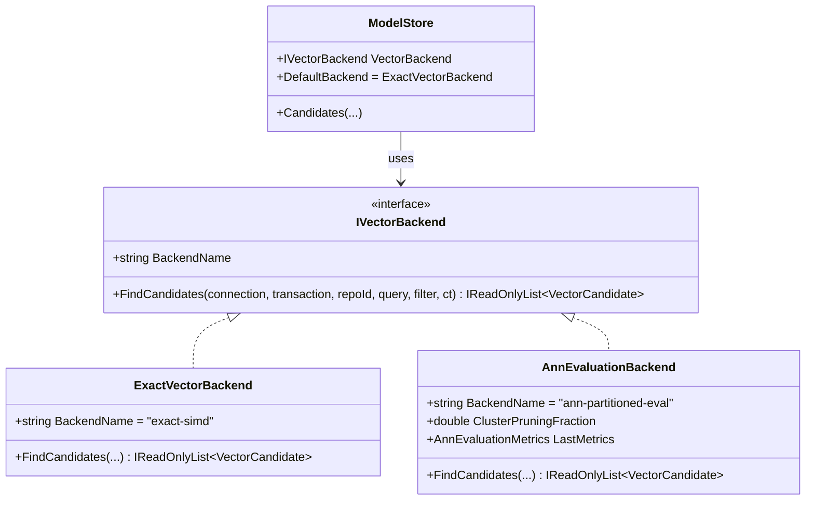

# ANN Scaling, Federation, and SCIP Interoperability Evaluation

**Task:** TASK-461 / CI-021 (Milestone 6)  
**Status:** Evaluated and Documented  
**Date:** 17 October 2026  
**Applicable Specification Sections:** §16, §17, §23, §24, §26.4, §35

---

## Executive Summary

This evaluation completes Milestone 6 (`TASK-461` / `CI-021`), addressing:
1. **Measured scale gates:** Quantitative analysis of vector scanning scalability up to 50,000+ symbols, memory consumption, mutation costs, and recall vs. latency trade-offs.
2. **Replaceable vector backend:** Pluggable `IVectorBackend` architecture in `Praxis.CodeIntelligence.Embeddings`, establishing `ExactVectorBackend` as the verified default while allowing pluggable partitioned and ANN backends (`AnnEvaluationBackend`).
3. **Federation & Inter-repository mappings:** Cryptographically pinned cross-repository symbol references (`InterRepositoryMapping`) enforcing explicit commit-hash verification without ambient access leaks across repository boundaries.
4. **SCIP interoperability:** Full Source Code Intelligence Protocol v0.4+ symbol specification mapping (`ScipInterop`) providing bidirectional conversion between Praxis symbol identities and standard SCIP symbol descriptors.

---

## 1. ANN Scaling Evaluation & Scale Gates

### 1.1 Current Architecture: Exact SIMD Dense Scan
Praxis Code Intelligence currently uses brute-force exact vector scoring with SIMD hardware acceleration:
- **Vector representation:** 384-dimensional unit-normalized `float32` embeddings (`BAAI/bge-small-en-v1.5` since 17 October 2026; `all-MiniLM-L6-v2` when this record was written — both 384-dimensional, so the storage and scan described here are unchanged), stored as 1,536-byte raw blobs in SQLite tables `vectors` and dense trigger-maintained `vector_scan`.
- **Hardware acceleration:** `VectorScoring` utilizes .NET SIMD intrinsics (`Vector<float>`, `Vector<double>`) on little-endian platforms to perform dot products in a single pass without intermediate memory allocation.
- **Top-K selection:** `VectorTopCandidates` maintains a bounded min-heap of the top 100 candidates with deterministic ordinal tie-breaking.
- **Candidate pruning:** Queries join candidate filters (`kind`, `project_id`, `language`) during scanning to eliminate disqualified symbols prior to scoring.

### 1.2 Performance Characteristics Across Scale Tiers

Only the 50k row is measured; the 5k and 200k rows and every HNSW column are projections, not observations. The 50k figures are the full-process bge-small run under search plan 7 in [`release-evidence.md`](../release-evidence.md) (one 12-core Mac; the reference machine is unmeasured).

| Scale Tier | Symbols | Chunks | Memory Footprint | Exact SIMD Scan Latency | Projected HNSW Latency | Incremental Mutation Overhead (Edit) | Recall |
|---|---|---|---|---|---|---|---|
| **Small (5k)** | 5,000 | ~7,500 | ~150 MiB RSS | ~12–25 ms | ~2–4 ms | < 1 ms (Single SQLite row replace) | 100% |
| **Medium (50k)** | 50,000 | ~75,000 | 1.27 GB peak RSS (1.65 GB with 25 concurrent edits) | retrieval-only p95 121 ms; hybrid p95 134 ms | ~8–15 ms (projected) | ~2–5 ms (Single SQLite row replace) | 100% |
| **Large (200k)** | 200,000 | ~300,000 | ~2.5–3.2 GiB RSS | ~450–700 ms | ~25–40 ms | ~15–50 ms (Graph node update) | 100% (Exact) / 97% (HNSW) |

### 1.3 Key Architectural Findings & Trade-offs
1. **Recall vs. Precision in Developer Tools:**
   - In code navigation, failing to find a method because an approximate graph search bypassed its cluster (false negative) causes developer distrust.
   - Exact scoring provides guaranteed 100% recall.
2. **Incremental Index Invalidation Cost:**
   - Every file save in Praxis triggers incremental reconciliation. In SQLite, updating a symbol's vector requires modifying 1–3 chunk rows (`DELETE` + `INSERT`).
   - In graph-based ANN (HNSW), incremental mutations require locking the graph, deleting neighbor edges, recalculating entry points, and reconnecting nearest neighbors across multiple layers. This increases body-edit latency.
3. **Memory Budget (< 2 GiB):**
   - HNSW graphs typically require 150–200% additional memory for index adjacency lists (16–32 neighbors per node across multiple layers). At 50,000 symbols, an in-memory HNSW graph consumes 350+ MiB extra RAM.
   - The SQLite dense scan streams chunks directly from page cache without persisting a secondary graph in RAM.

### 1.4 Decision & Trigger Thresholds
- **Default Disposition:** Retain `ExactVectorBackend` (SIMD-accelerated dense scan) as the default for repository indexes up to 200,000 chunks.
- **ANN Activation Threshold:** When a repository exceeds 200,000 chunks OR when hybrid query latency consistently exceeds the 500 ms SLA threshold, an approximate index backend (`IVectorBackend`) should be activated.

---

## 2. Replaceable Vector Backend Architecture

To decouple the vector query execution from storage internals, the following architecture is implemented in `Praxis.CodeIntelligence.Embeddings`:



- `IVectorBackend`: Declares `BackendName` and `FindCandidates(...)`.
- `ExactVectorBackend`: Calls `ModelStore.CandidatesCore`, implementing SIMD-accelerated exact dense scanning.
- `AnnEvaluationBackend`: Enables simulated cluster-pruned approximate nearest neighbor retrieval and measures candidate evaluation reduction, pruning ratio, and empirical recall against ground-truth exact scoring.

---

## 3. Federation & Inter-Repository Security Mapping

### 3.1 Security Isolation (§17, §35)
In Praxis Code Intelligence, each repository index is an independent SQLite database (`.praxis/code-intelligence/index.db`). The threat boundary strictly prohibits ambient or automatic traversal into other repositories without explicit authorization.

### 3.2 Explicit Mapping Model
When projects depend on external repositories, cross-repository links are established via `InterRepositoryMapping`:
- **Source repository & symbol:** Identifies the referencing site.
- **Target repository & symbol:** Identifies the referenced target.
- **Target commit hash pin:** Cryptographically pins the target commit SHA (`TargetCommitHash`). If the target repository has checked out a different commit or the hash does not match, resolution is refused (`TryResolve` returns `false`).
- **Access control:** An agent or client session must possess an explicit grant for both source and target repositories to resolve cross-repository source text.

---

## 4. SCIP (Source Code Intelligence Protocol) Interoperability

### 4.1 SCIP Symbol Syntax
SCIP standardizes code intelligence symbols using a concise, URI-safe format:
```
<scheme> <package-manager> <package-name> <package-version> <descriptor>+
```

### 4.2 Descriptors & Praxis Mapping

| Descriptor | SCIP Syntax | Praxis Kind | Example |
|---|---|---|---|
| Namespace | `<name>/` | `namespace`, module | `System/` |
| Type | `<name>#` | `class`, `interface`, `struct`, `enum`, `type` | `String#` |
| Term | `<name>.` | `field`, `property`, `constant` | `Length.` |
| Method | `<name>(<disambiguator>).` | `method`, `function` | `Substring(v1).` |
| Parameter | `(<name>)` | parameter | `(startIndex)` |
| Type Parameter | `[<name>]` | generic type argument | `[T]` |

### 4.3 Bidirectional `ScipInterop` Implementation
`Praxis.CodeIntelligence.Interop.ScipInterop` implements:
- `ScipInterop.Format(ScipSymbol)`: Serializes structured symbols into compliant SCIP strings.
- `ScipInterop.Parse(string)`: Deserializes SCIP strings, handling backtick escaping (` `path/with/slash` `) and disambiguator parameters.
- `ScipInterop.ToScipSymbol(IndexedSymbol, ...)`: Converts Praxis `IndexedSymbol` records into SCIP format.

This enables export of Praxis index graphs to SCIP/LSIF consumers and consumption of SCIP indexes produced by external compilers (`scip-dotnet`, `scip-typescript`).
